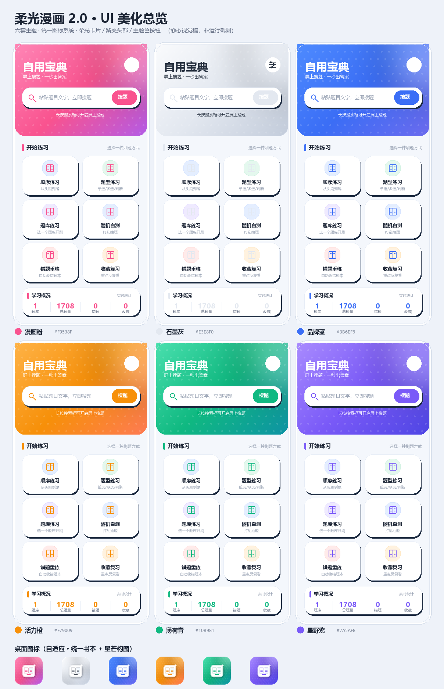

# 自用宝典 · 柔光漫画 2.0

一个纯本地的「搜题 / 练题」Android App。通过无障碍服务读取屏幕上的题目文字，在悬浮窗里即时给出本地题库中的答案；同时提供题库导入导出与练习功能。

**无网络请求、无账号体系、无数据上传，所有数据仅存本机数据库。**



## 功能

- **屏上搜题**：开启无障碍服务后，悬浮球 / 答案卡片自动匹配当前屏幕题目
- **手动搜题**：粘贴题目文字，本地检索
- **练习模式**：顺序 / 题型 / 题库 / 随机 / 错题 / 收藏，支持选项打乱、跳题、搜题
- **题库管理**：导入 `.txt` / `.docx` / `.json` / `.csv`，导出纯文本，多题库启用切换
- **六套主题**：漫画粉 / 石墨灰 / 品牌蓝 / 活力橙 / 薄荷青 / 星野紫，桌面图标与名称随主题联动
- **悬浮窗自定义**：背景 / 文字透明度、字号、颜色、悬浮球样式与位置

## 技术栈

| 项 | 值 |
|---|---|
| 语言 | Kotlin + ViewBinding |
| minSdk / targetSdk / compileSdk | 23 / 34 / 34 |
| JDK | 17 |
| Gradle | 8.7（工程自带 wrapper） |
| 依赖 | AndroidX、Material 3；无网络库 |

## 构建

1. 用 Android Studio 打开工程根目录（Open，不要 Import）。
2. 在工程根目录创建 `local.properties`，写入本机 SDK 路径：
   ```properties
   sdk.dir=[ANDROID_SDK_PATH]
   ```
   或让 Android Studio 自动生成。该文件已被 `.gitignore` 排除。
3. 准备 JDK 17：让 `JAVA_HOME` 指向 JDK 17，或在 `gradle.properties` 里设置 `org.gradle.java.home=[JDK17_PATH]`；Android Studio 中同时设置 `Gradle JDK = 17`。
4. 首次构建会联网下载 Gradle 与依赖。

```bash
./gradlew assembleDebug
./gradlew assembleRelease
```

产物位于 `app/build/outputs/apk/`。

### 关于签名

工程**不包含签名密钥**。`keystore.properties` 与 `keystore/` 已加入 `.gitignore`，发布签名需自行准备：

1. 用 `keytool` 生成自己的密钥库；
2. 参照 [`keystore.properties.example`](keystore.properties.example) 填写 `storeFile` / `storePassword` / `keyAlias` / `keyPassword`；
3. 不配置也可以正常构建 debug 包（使用默认 debug 签名）。

替换密钥库会改变证书指纹，已安装用户将无法覆盖升级，请妥善保管自己的密钥。

## 目录

```
app/src/main/
├── java/com/ziyongbaodian/
│   ├── data/       Db.kt（SQLite）、Prefs.kt、模型
│   ├── search/     QParser / ScreenOptions / SearchEngine
│   ├── service/    ScreenSearchService（无障碍）、FloatWindow（悬浮窗）
│   ├── ui/         MainActivity、PracticeFragment、SettingsActivity 等
│   ├── util/       Themes、DocxText、BankExport、Util
│   └── widget/     ColorPickerView
├── res/            layout / drawable（shape + vector）/ values / mipmap
├── assets/         demo_bank.txt
└── AndroidManifest.xml
tools/              资源生成与静态校验脚本（不参与构建）
design/             设计预览图
```

## 主题机制

六套主题定义在 `values/themes.xml`，顺序即 `Themes.ALL` 索引，与 `AndroidManifest.xml` 的 `activity-alias`、`Themes.ALIASES`、桌面图标一一对应。布局与 drawable 一律引用 `?attr/colorPrimary` 等属性，不写死品牌色。

新增 Activity 必须继承 `BaseActivity`，否则 `setTheme()` 不生效。新增主题需同时补齐：style、主色、头部渐变、桌面名、adaptive 图标、manifest alias。

## 题库格式

```
一、单选题
1、计算机中 1KB 等于多少字节？
A、1000
B、1024 字节
答案：B

二、多选题
2、以下属于输入设备的是？
A、键盘
B、鼠标
答案：AB

三、判断题
3、TCP 是面向连接的协议。
答案：正确
```

## 复现与自检

`tools/` 下的脚本幂等，改配色 / 构图后重跑即可：

```bash
python tools/gen_ui_kit.py             # drawable shape / selector / 矢量图标
python tools/gen_launcher_ui.py        # 六套启动图标 PNG + 预览
python tools/gen_mipmap_vectors.py     # API<26 fallback 矢量 + adaptive 声明
python tools/verify_ui.py              # 静态完整性校验（178 个 XML / 资源引用 / id / 主题链路）
python tools/cleanup_unused_images.py  # 清理零引用历史图片
```

> `gen_icons.py` / `gen_launcher*.py` / `gen_shapes*.py` 为旧版历史脚本，重跑会用旧构图覆盖新图标，请勿执行。

## 已知注意事项

- 部分定制系统重装后会重置无障碍授权，需重新到系统设置开启。
- Git Bash 下 adb 路径参数会被 MSYS 改写，涉及 `/sdcard/...` 时先 `export MSYS_NO_PATHCONV=1`。
- 切换桌面图标后个别机型桌面缓存不刷新，等几秒或重启桌面即可。

## 使用边界

题库内容由使用者自行导入，请在遵守考试纪律与相关法律法规的前提下使用本项目。本项目仅提供本地检索与练习工具，不提供任何题库内容、不联网、不代替学习。

## 许可证

[MIT](LICENSE) — 详见 LICENSE 文件。
